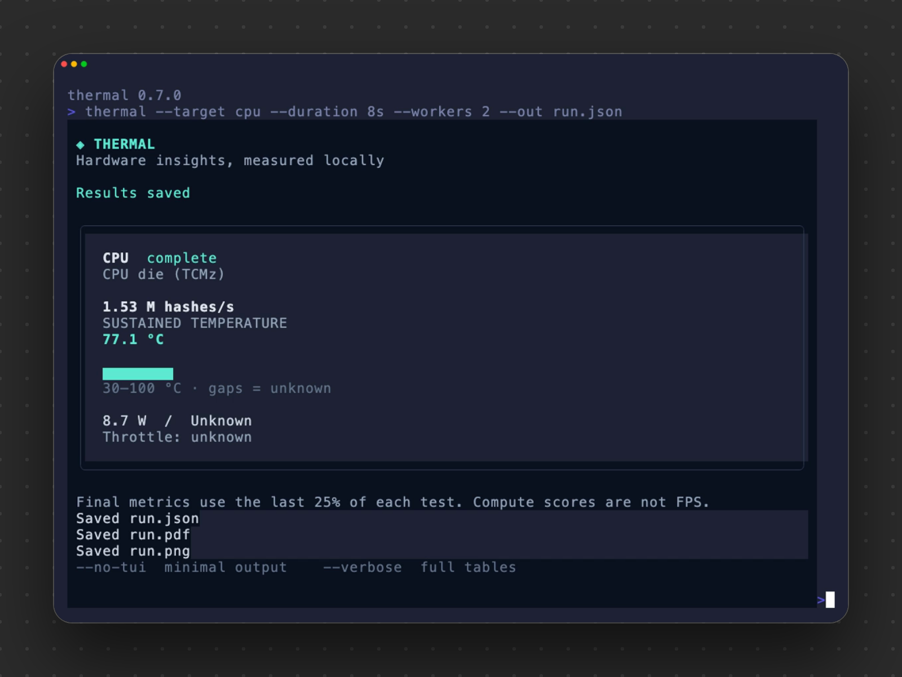
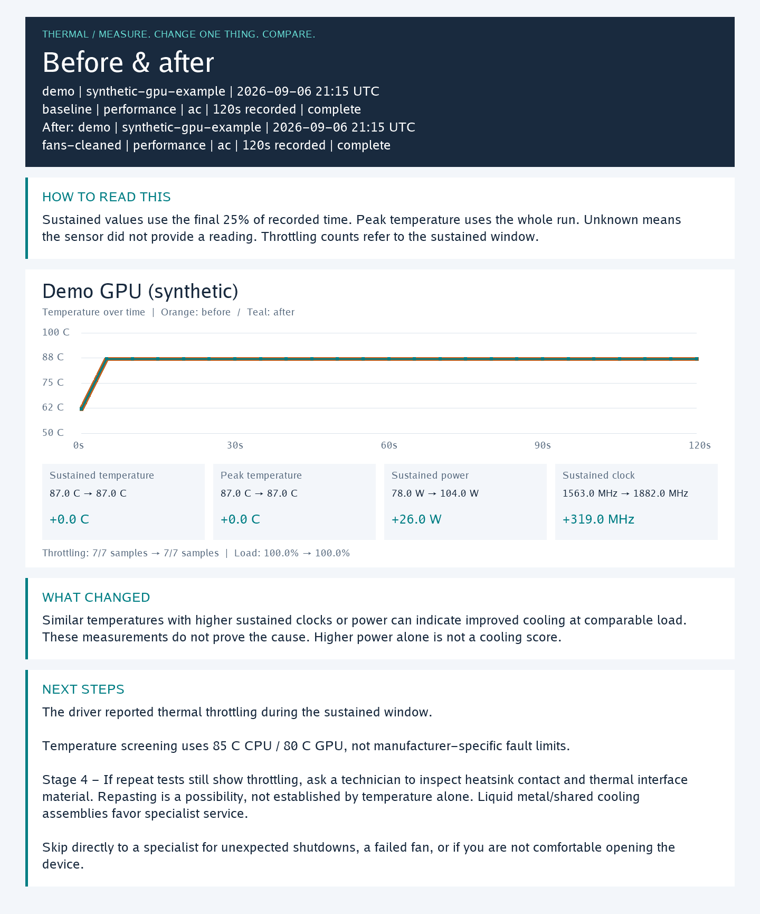
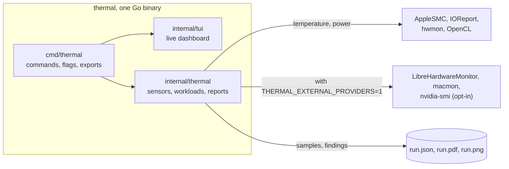

# Thermal

<p align="center"><a href="https://preacherxp.github.io/30-days-of-tools/"></a></p>

<p align="center"><a href="https://buymeacoffee.com/michal.hachula"></a></p>

A command line tool for macOS, Windows and Linux that benchmarks your CPU and GPU under monitored load, records temperatures and compares runs from before and after a fix.

You run `thermal` and it loads the CPU for 30 seconds, then the GPU for 30 seconds, while a live dashboard shows the temperature, wattage and progress. It stops at 90 °C, and it refuses to start a test when it can't read that part's temperature. When it finishes, it saves the run as JSON, a PDF of findings and a PNG summary. Change one thing, such as cleaning the fans or closing apps, run it again, and `thermal compare` shows what moved. It is one standalone binary with no runtime, and your data stays on your machine.

<p align="center"></p>

<p align="center"><a href="examples/demo.mp4"></a><br><sub>An eight second CPU benchmark on Apple Silicon with two workers. Click for the video.</sub></p>

## Requirements

- macOS, Windows or Linux, on x64 (`amd64`) or ARM64 (`arm64`).
- A readable temperature for each part you benchmark. macOS reads AppleSMC natively: the CPU die and, on Apple Silicon, the GPU. Linux reads kernel `hwmon` sensors. On Windows the CPU temperature needs [LibreHardwareMonitor](https://github.com/LibreHardwareMonitor/LibreHardwareMonitor) running with `THERMAL_EXTERNAL_PROVIDERS=1` set, so the CPU test is refused without it.
- An OpenCL GPU for the GPU benchmark: the system OpenCL framework on macOS, or an installed OpenCL GPU driver on Windows. Linux has no GPU benchmark.
- Go 1.26.8 or later to build it. No cgo.

## Install

On macOS or Linux:

```sh
curl -fsSL https://github.com/preacherxp/thermal/releases/latest/download/install.sh | sh
```

On Windows, in PowerShell:

```powershell
curl.exe -fsSL https://github.com/preacherxp/thermal/releases/latest/download/install.ps1 -o install.ps1
if ($LASTEXITCODE -eq 0) { powershell.exe -NoProfile -ExecutionPolicy Bypass -File .\install.ps1 }
```

Both installers pick your architecture, verify the SHA-256 checksum and need no administrator access. They put `thermal` in `~/.local/bin` on macOS and Linux, or `thermal.exe` in `%LOCALAPPDATA%\Thermal\bin` on Windows. Set `THERMAL_INSTALL_DIR` to choose another directory, and add it to your `PATH` if the installer says so:

```sh
export PATH="$HOME/.local/bin:$PATH"
```

Or grab an archive from [GitHub Releases](https://github.com/preacherxp/thermal/releases/latest) and extract it; macOS archives are named `darwin`. Run `chmod +x thermal` if your extraction tool drops the executable bit.

From source:

```sh
git clone https://github.com/preacherxp/thermal.git
cd thermal
go run ./scripts/dist build --local   # writes dist/<os>-<arch>/thermal
```

Check the version with `thermal --version`. To update, run the installer again. To uninstall, delete the binary and your saved runs: `rm ~/.local/bin/thermal`, then remove `~/Library/Application Support/thermal` on macOS or `~/.config/thermal` on Linux. On Windows, delete `%LOCALAPPDATA%\Thermal` and `%APPDATA%\thermal`.

### Troubleshooting

`Get-FileHash is not recognized` on Windows means your PowerShell host lacks that cmdlet. The [installer in this repo](install.ps1) hashes with .NET instead. Run it from the repository root with the release you want:

```powershell
powershell.exe -NoProfile -ExecutionPolicy Bypass -File .\install.ps1 -Version v0.7.0
```

A test marked refused means no temperature sensor was readable for it. See what Thermal can read:

```sh
thermal doctor
```

## Usage

```sh
thermal                                   # CPU, then GPU, 30 seconds each
thermal --target cpu                      # one part only: cpu, gpu or both
thermal --duration 60s --out run.json     # longer tests, your own file name
thermal record --survey skip --workload my-game --duration 120s   # watch a running game, no added load
thermal compare before.json after.json --pdf comparison.pdf --png comparison.png
thermal report run.json                   # full tables for a saved run, no load
thermal history                           # list saved runs
thermal demo --pdf demo.pdf --png demo.png   # a synthetic report, no load
thermal --help                            # every command and option
```

In a terminal it opens a live dashboard. `--no-tui` prints minimal output instead, and `--verbose` prints full tables. Pipes, `--json`, `NO_COLOR` and `TERM=dumb` fall back to minimal output on their own.

| Key | Action |
| --- | --- |
| `q`, `Esc` or `Ctrl+C` | Stop the test and save what was measured |

- **Benchmark.** The CPU test hashes SHA-256 on up to four workers and scores in hashes per second. The GPU test runs integer work on OpenCL, checks the results on the CPU and scores in iterations per second. Neither is a gaming FPS figure.
- **Stop limit.** A test stops when its temperature reaches 90 °C. Change it with `--stop-temp`, from 50 to 100. `--allow-unmonitored` runs a test with no temperature reading, which you should only do on purpose.
- **Record.** `thermal record` adds no load. Start a game or render first and Thermal watches it.
- **Compare.** Run the same workload under the same conditions, change one thing, and run it again. Label what you changed with `--stage`: `baseline`, `apps-closed`, `profile-changed`, `fans-cleaned`, `repasted` or `specialist`. The comparison uses the last 25% of each run, as after minus before.
- **Findings.** The PDF has an overview, a page per part with charts, and a suggested next step. Its thresholds are general cues, not a diagnosis of your device.

<p align="center"><br><sub>A comparison PNG, made with <code>thermal demo</code>.</sub></p>

Each run saves `run.json`, `run.pdf` and `run.png` to your config directory: `~/Library/Application Support/thermal/runs` on macOS, `~/.config/thermal/runs` on Linux (or `$XDG_CONFIG_HOME`) and `%APPDATA%\thermal\runs` on Windows. `THERMAL_DATA_DIR` moves them, `--out`, `--pdf` and `--png` pick the paths, and `--no-pdf` and `--no-png` skip either export. Existing files are never overwritten. Nothing leaves your machine.

More examples are in [RUN.md](RUN.md), and the [automation guide](AGENTS.md) covers JSON output and exit codes.

## Limits

- Temperature checks are best effort. They do not replace your hardware's own protection.
- Windows has no native CPU temperature here. Run LibreHardwareMonitor and set `THERMAL_EXTERNAL_PROVIDERS=1`, or the CPU test is refused. The GPU test still runs.
- The GPU benchmark needs OpenCL, which Apple has deprecated. Linux and machines without an OpenCL GPU report it as unavailable.
- Intel and discrete GPUs on macOS need a sensor provider that names the exact GPU, because Thermal never guesses which sensor belongs to it.
- Apple Silicon wattage comes from IOReport as an energy model estimate averaged over each interval, not wall power. Other platforms show what their sensors expose, and overlapping power channels are never added together.
- Missing readings stay unknown, never zero. A refused or partial test stays in the report, and the command exits with code 1.
- Temperatures alone can't prove a cooling fault or what caused a change.

## Architecture



- **`cmd/thermal`** parses commands and flags, runs the capture and writes the JSON, PDF and PNG files. A bare `thermal` is shorthand for `benchmark --target both --survey skip`.
- **`internal/tui`** is the dashboard, built with Bubble Tea and Lip Gloss. If the dashboard fails, Thermal never starts another workload, and it restores the terminal on exit.
- **`internal/thermal`** reads the sensors, runs the workloads and draws the reports. It calls AppleSMC, IOReport, OpenCL and the Windows DLLs directly, without cgo, so every build is a single cross-compiled binary. A GPU sensor must match the device under load exactly, because a reading from another GPU would look like monitoring when it isn't. The PDF and PNG are drawn in Go with an embedded font, so they look the same everywhere.

Thermal only reads sensors and never changes fan curves, power profiles or clocks. `--profile`, `--power` and `--stage` only label a run.

## Development

```sh
go mod download
go test ./...                          # unit tests, with fake GPU sessions and short CPU loads
go vet ./...
go run ./scripts/dist check-deps       # checksums, license coverage, all six targets
go run ./scripts/dist build --local    # dist/<os>-<arch>/thermal
go run ./scripts/dist build            # all six targets
go run ./scripts/dist package          # archives, installers and checksums in release/v<version>/
```

`THERMAL_TEST_NATIVE=1 go test ./scripts/smoke -count=1` checks the built binary, and `THERMAL_TEST_BENCHMARK=1 go test ./cmd/thermal -run TestNativeDefaultBenchmark -count=1` runs the real default benchmark under monitored load. [AGENTS.md](AGENTS.md#development) lists the installer tests. CI publishes a release when a matching version tag is pushed.

To regenerate the recording, install [VHS](https://github.com/charmbracelet/vhs), `ffmpeg` and `ttyd`, put `thermal` on your `PATH`, then run `vhs examples/demo.tape` from the repository root. It runs a real CPU benchmark in a temporary directory and writes `examples/demo.gif` and `examples/demo.mp4`.

## License

[MIT](LICENSE). Third party notices are in [THIRD_PARTY_NOTICES.txt](THIRD_PARTY_NOTICES.txt) and [THIRD_PARTY_LICENSES.txt](THIRD_PARTY_LICENSES.txt).

<sub>If it tells you whether your laptop is auditioning to become a space heater, you can [buy me a coffee](https://buymeacoffee.com/michal.hachula).</sub>
